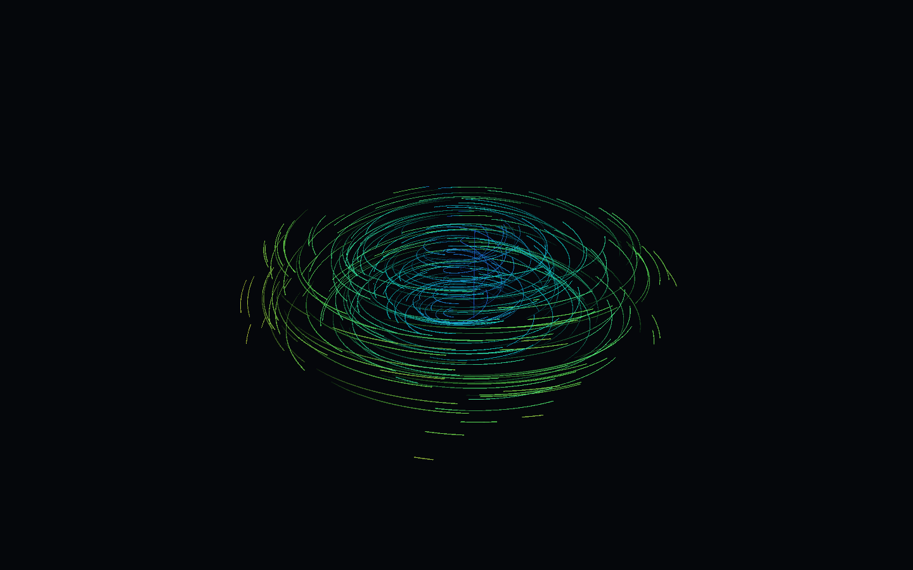
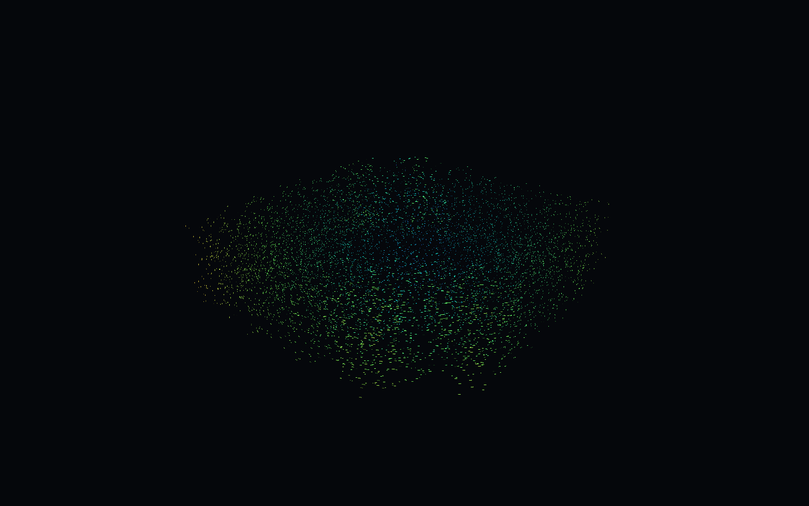

# Unity 通用矢量场可视化

可嵌入普通 Unity 场景的局部 XYZ 矢量场显示模块。Long 使用双向 RK4 生成流线并沿路径显示渐隐轨迹；Short 使用 Compute Shader 更新按流向排列的短粒子。数据、色带、显示速度、数量和 GPU 资源按实例独立管理。

| Long：长流线 | Short：短粒子 |
| --- | --- |
|  |  |

## 环境与运行

- 项目版本：**Unity 2022.3.62f3c1**，沿用原型的中国版 Unity；不是本次改为团结引擎。其他 Unity/Tuanjie 版本未作兼容性承诺。
- 渲染管线：**Built-in**。需要 Compute Shader、Shader Model 4.5、浮点 Texture3D 和结构化缓冲；本次验证目标是 Windows / Direct3D 11。URP、HDRP、WebGL、移动端未适配。
- 依赖通过 `Packages/manifest.json` 与锁文件恢复；测试使用 Unity Test Framework。沿用原型的包版本，后处理等现有包不是核心显示前提。不包含私有 DLL、内网服务或额外数据下载。

1. 用上述 Unity 版本打开项目，等待包恢复及资源导入。
2. 打开 `Assets/Samples/Scenes/VectorFieldDemo.unity`，进入 Play。
3. 按 **1 / 2** 或左上角按钮切换 Long / Short；按钮切换浅层、深层或平面数据，**R** 重新加载。
4. 显示速度滑块调整动画倍率；Stop/Show 停止或重新显示。右键观察，WASD 移动，Q/E 升降，Shift 加速。

演示组件在 Play 时从解析公式创建数据；场景外观不依赖导入的数据文件。菜单 **Vector Field / Generate synthetic data and demo scene** 可重新生成场景和两份文本（会覆盖这三个示例产物，请先保存自己的场景修改）。

## 数据、坐标与单位

- `VectorFieldGrid` 接收递增的 **X / Y / Z** 三条坐标轴、`Vector3[]` 矢量和可选 `bool[]` 有效性。索引为 `x + nx * (y + ny * z)`，位置与分量均按 XYZ 顺序。
- 支持非等距直角网格；X、Z 各至少两个点。Y 可只有一层，此时运动约束在 XZ 平面，原始垂直分量仍保留在物理矢量和色标中。默认演示的位置为米、矢量为米/秒；核心不预设经纬度、风场/洋流类别或固定 400×400 范围。
- `valid=true` 的 `(0,0,0)` 是真实静止数据；`valid=false` 是缺测。插值要求单元所有角点有效，缺测不被当作零值补齐。静止区可以采样，但不会产生移动粒子或流线。
- `VectorFieldMapping.origin` 是数据坐标原点；`positionUnitsToLocal` 将数据位置单位换成 Unity 局部显示单位，默认 `(1,1,1)`；`velocityUnitsToPositionUnits` 将一个速度单位换成每秒的数据位置单位，默认 1。例如位置为千米、速度为米/秒时设 `.001`。
- 位置映射为 `(dataPosition-origin) * positionUnitsToLocal`；局部速度为 `physicalVelocity * velocityUnitsToPositionUnits * positionUnitsToLocal`。根对象的 Transform 再将位置和方向映射到场景；缩放会同时改变显示范围、运动距离和图形尺寸。两种模式使用数据组件的 Transform。
- 物理速度和配色依据始终来自原始矢量模长；显示速度倍率不修改它。`colorSpeedUnitMultiplier` 仅转换色标单位，例如从米/秒到千米/时设 3.6。色带、上下限和单位显式配置，无 ID 区间规则。高度夸张默认 1。

可选的 `Assets/Adapters` 提供桌面文本读取：

```text
# x y z vx vy vz valid
0 0 0 1 0 0 1
1 0 0 0 0 0 1
0 0 1 0 0 0 0
1 0 1 1 0 0 1
```

LocalXYZ 格式每行严格七列，空白、逗号或竖线分隔，数值使用小数点。重复坐标、非递增轴与有效样本中的非有限数值会被拒绝；缺少的坐标组合为缺测。`VectorFieldFileLoader` 负责异步读取和取消；不把外部文件复制进项目。旧六列 `lon lat altitude east up north` 需明确选择 `LongitudeLatitudeAltitude`，采用域中心纬度的局部近似，仅适合小范围，不是完整 GIS 投影。

公开示例位于 `Assets/Samples/Data/`。生成器 `SyntheticVectorField.Create/Write` 使用固定解析螺旋场，包含静止区域和缺测角落：浅层范围 `40×12×40 m`；深层范围 `28×24×18 m`、Y 为 `-24…0 m`。没有真实天气、海流或地形数据。

## 主要控制项

| 参数 | 含义 |
| --- | --- |
| `mode` | Long / Short；没有强制 Short 的开关 |
| `lineWidth / trailLength` | Long 局部宽度 / 可见拖尾步数 |
| `stepSize / maxSteps` | Long 局部弧长步距 / 双向积分总步数上限 |
| `maxStreamlines / minSpacing` | Long 条数上限 / 种子局部间距；改后调用 `Long.Rebuild()` |
| `particleScale / baseAspect / stretchMult` | Short 局部尺寸 / 基础长宽比 / 按物理速度拉伸 |
| `streamlineSpeed / speedMultiplier` | 两模式显示倍率，默认 1；0 暂停运动 |
| `minColorSpeed / maxColorSpeed` | 显式色标范围；上限不大于下限时使用数据最大物理速度乘色标单位倍率 |
| `automaticParticleCount` | Short 自动 / 固定分配 |
| `mainParticleCount × fixedParticleCountUnit` | 固定模式申请数量；0 为不分配，不代表自动 |
| `automaticReferenceSize` | 自动模式参考尺寸，局部显示单位；平面模式只使用 XZ 面积 |
| `automaticReferenceParticleCount` | 该参考面积/体积对应的数量，独立可调 |
| `automaticParticleLimit` | 两种数量策略的分配上限，0 为不分配 |

自动数量为 `round(参考数量 × 估算可见面积或体积 / 参考面积或体积)`，非空时至少 1，再受上限约束。出生单元按面积/体积抽样，单元内拒绝缺测、静止、低于可见阈值和透明色带位置，不按速度加权增加密度。可见度参数或数量配置改变时重建分配；动画速度和尺寸可直接调整。

## 嵌入自己的场景

复制 `Assets/Scripts`、`Assets/Shaders` 和需要的两个材质；`Assets/Samples` 与 `Assets/Adapters` 可分别省略。`VectorField.Core` 和 `VectorField.Runtime` 不引用示例或适配程序集。

在一个对象上添加 `VectorFieldInstance`，它会补齐最小组件：`WindFieldData`、`WindColorRamp`、`StreamlineSystem`、`WindParticleSystem`。历史类名保留，但数据输入已通用化。给 Short 指定 `WindFieldCompute.compute` 和 `Mat_FlowParticle.mat`，给 Long 指定 `StreamlineSkeleton.mat`。材质与计算着色器资产可跨实例复用，运行时会各自实例化。

```csharp
// 在 Unity 主线程调用；instance 已按上面步骤配置好资源。
var map = VectorFieldMapping.Identity;
map.origin = new Vector3(-20, 0, -20);
instance.SetMode(VectorFieldMode.Short);
instance.Short.automaticReferenceSize = new Vector3(40, 12, 40);
instance.Short.automaticReferenceParticleCount = 10000;
instance.Short.automaticParticleLimit = 50000;
instance.SetColorRange(0, 5); // 数据为 m/s；独立的色带通过 SetPalette(Gradient) 配置
instance.SetDisplaySpeed(1);
instance.Load(new VectorFieldGrid(xAxis, yAxis, zAxis, velocities, validity), map);
instance.SetMode(VectorFieldMode.Long);
instance.Stop();   // 停止显示并释放两种显示器的缓冲；保留数据
instance.Show();   // 按当前模式重建
instance.Unload(); // 同时释放数据纹理，取消旧计算
```

调用 `SetMapping` 可重新映射已加载数据。`TrySampleLocal` 返回是否有效及原始矢量；`SamplePhysicalVector(worldPosition)` 返回原始矢量，`SampleWorldVelocity(worldPosition)` 返回经单位映射和 Transform 后的场景速度。网格拥有输入数组副本，后台任务捕获不可变帧，替换、切换和卸载通过取消标记与版本检查避免旧结果覆盖新数据。

## 验证与限制

实际结果、复测命令和截图来源见 [验证记录](docs/VALIDATION.md)。不提供未经测量的帧率或容量承诺。

- 只处理静态、轴对齐的直角网格；非结构网格和随时间变化的数据需外部重采样/更新。
- Long 是有限长度的静态流线及沿线动画，不是严格时间积分的拉格朗日轨迹；开放路径头部会重新从起点开始。显示步进有离散误差。
- 自动可见面积/体积是每单元 4/8 点求积估算；极窄可见速度带可能估计不足。Short 每次最多尝试 32 个出生位置，失败者隐藏并于后续帧重试。
- 透明粒子不做逐粒子深度排序；没有沙盘雾化背景层或跨管线适配。大网格受显存和 Texture3D 维度限制；本次不宣称极限性能。
- 原型的旧场景、原始数据和设计记录保存在本地忽略目录中，不在发布候选内。示例菜单生成新场景，不恢复旧业务演示。
- 项目代码及本仓库自有示例采用 [MIT 许可证](LICENSE)。Unity 与包依赖遵循其各自许可证；MIT 不替代这些第三方条款。

发布快照的范围见 [公开准备说明](docs/PUBLICATION.md) 和根目录 `PUBLISH_FILES.txt`。原型的 Git 历史与原始数据不属于此发布快照。
